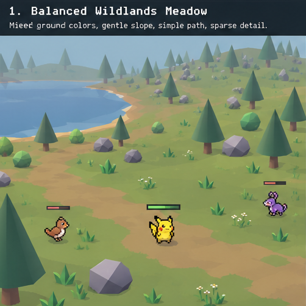
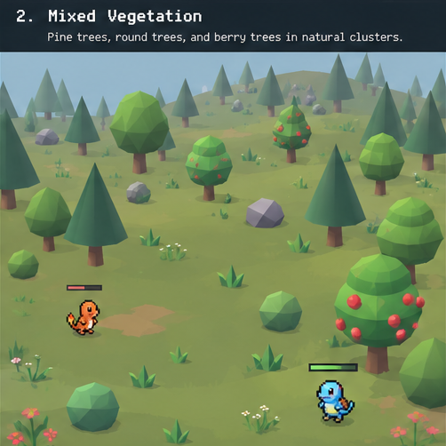
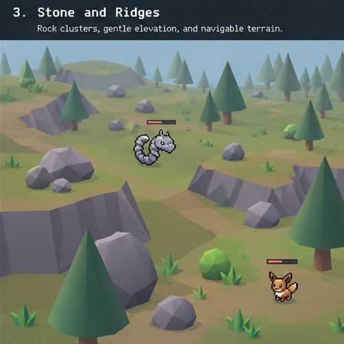
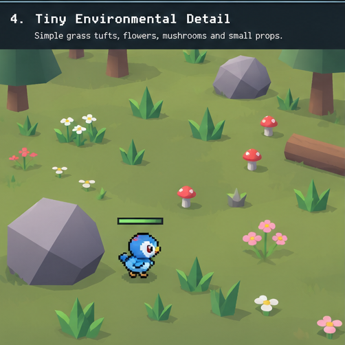
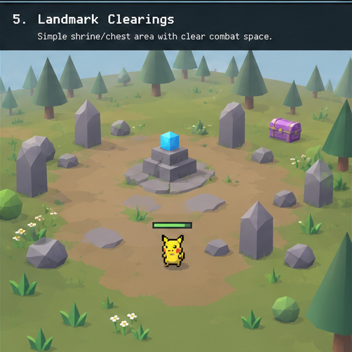
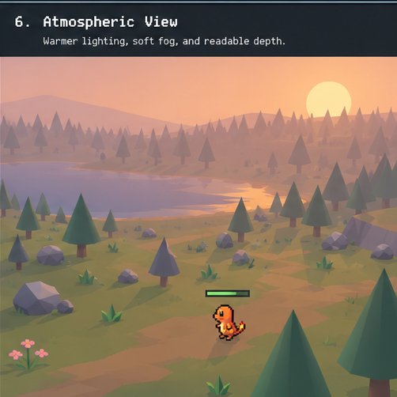
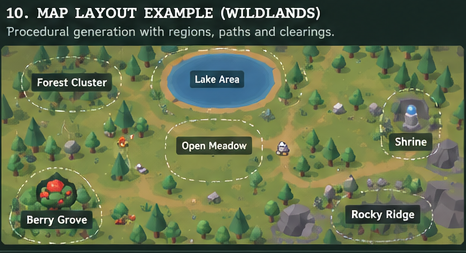
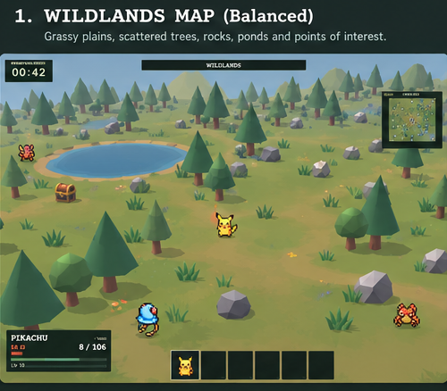
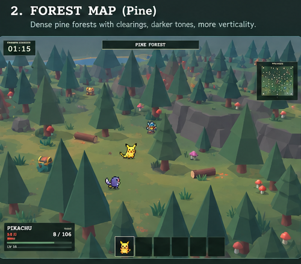
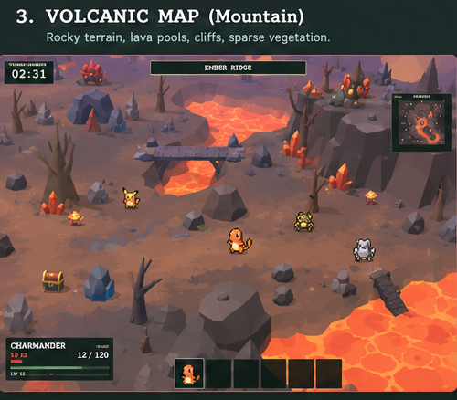

# Wildlands — Three-Biome Visual Overhaul
## Production art direction, references, staged Codex prompts, and verification plan

**Status:** Implementation brief; NOT a claim that your current repository has been inspected or modified.  
**Based on:** Your October 2026 Wildlands screenshot and your 15 art-direction answers.  
**Target:** Existing browser game with Babylon.js, TypeScript, Vite, crisp 2D Pokémon sprites, third-person camera.  
**Maps already present:** (1) balanced Wildlands, (2) pine/forest, (3) mountainous/volcanic. Actual in-repository keys/names must be discovered by Codex.  
**Visual north star:** *Muted Megabonk meets Pokémon Mystery Dungeon*. Sprites stay crisp and vibrant; world stays intentionally simple, readable, slightly toy-like, and flat-shaded. The goal is a game Codex can build, not expensive concept art.

> **Use:** Open this file in the repository alongside the `/references` images. Give Codex **ONE numbered prompt per run**, beginning with Prompt 00. Review screenshots and commit after each stage. Prompts deliberately instruct the agent to inspect the **current** repository before selecting file names; your live project has evolved since its first prototype. All illustrative numeric scales must be calibrated to actual world units before implementation.

---

## 0. Selected visual decisions — do not re-ask

| Topic | Decision |
|---|---|
| Color | B/C: primarily muted Megabonk with a little more intentional Pokémon color |
| Balanced map | C: meadows + forests + rocky pockets, **not** a rigid route |
| Pixel art | A: keep Pokémon as pixel sprites; geometry and props stay clean, low-poly 3D |
| Trees | D: mixed conifers, rounded deciduous, berry trees |
| Ground | D: largely flat colors, a few simple geometry-based decorations |
| Ground clutter | A: sparse |
| Rocks/cliffs | A: retain existing faceted rocks; improve color, placement, and a few sizes |
| Exploration | A: open terrain, scattered recognizable landmarks, no forced trail network |
| Verticality | B: gentle hills, limited ridges and occasional elevated areas |
| Atmosphere | D: time-of-day progression during the run |
| Water | B: decorative pond(s) / small streams, where map identity suits them |
| Landmarks | B: simple distinctive mini-environments around existing interactables |
| Asset complexity | A/B: chiefly simple primitives, occasional tiny custom low-poly meshes |
| Map generator | B; C only if necessary: evolve existing generation, do not casually replace |
| Performance | B: balanced, but combat readability and stable performance always win |

**Preserve gameplay:** player movement, jump/dodge, sprite billboarding and nearest-neighbor filtering, combat/XP, enemy spawns, boss, minimap, shrines, chests, berries, timers, collisions, save state, and pause behavior. No new gameplay systems are requested by this art pass.

### Three maps must feel different

| Map | Terrain colors | Vegetation | Stone / water | Silhouette and atmosphere |
|---|---|---|---|---|
| **Balanced Wildlands** | Sage green, olive, occasional dusty paths/patches | Mixed pine + rounded trees, some berry groves | Existing grey stones, shallow blue pond, gentle banks | Open combat clearings, medium visibility, welcoming muted sunlight |
| **Pine Forest** | Darker moss green, shaded forest floor, modest brown clearings | Strong pine majority, tight-but-navigable clusters, occasional shrubs and berry trees | Darker stone, logs/stumps, rare small woodland pool | Taller denser tree silhouette, cool mist, readable clearings |
| **Volcanic Mountain** | Warm grey/brown rock, rust soil, selective charcoal patches | Sparse dead wood; ordinary green trees essentially absent unless intentional oasis | Existing faceted boulders, ridge edges, optional lava as *visuals* where it already exists | Dramatic rocky silhouette, warm haze; simple red-orange accents; no fancy lava shader |

**Do not make the three maps recolored duplicates.** Use shared factories but independently tunable biome profiles and distribution rules. The visual references show a target *style and silhouette*; do not reproduce their UI text, Pokémon placement, map layout, or every decorative detail.

---

## Reference images — individually implementable targets

These cropped references were generated as **low-poly design studies**, not literal wireframe renders. For Codex, the accompanying geometry specifications are authoritative. When an image seems more complicated than the specs, **build the simpler spec**.

## Visual Reference Workflow

Before implementing a stage, the implementing agent must open and visually inspect the exact primary and supplementary PNG files listed in that stage's **MANDATORY VISUAL REFERENCE** section. Do not infer their contents from filenames, alt text, or written descriptions. Analyze their colors, silhouettes, proportions, geometry complexity, object density, and overall art direction. Treat them as achievable visual targets, not literal assets to insert into the game: the written technical specifications win whenever a generated image implies impractical geometry, detailed textures, elaborate shaders, or anything that conflicts with the existing architecture, performance requirements, or gameplay systems. Preserve the crisp Pokemon-sprite aesthetic and established Wildlands identity; never add complex models, detailed textures, or elaborate shaders merely to imitate a reference.

After implementation, capture an actual screenshot at the normal gameplay camera angle whenever the environment supports browser screenshots, compare it directly with the original primary and supplementary references, and correct significant visual discrepancies before declaring the stage complete. If any named image cannot be opened and visually inspected, or a browser screenshot cannot be captured, explicitly report that limitation rather than claiming the comparison occurred.

The primary target identifies the visual focus of its stage. Supplementary references supply biome-specific context and must also be inspected; they do not expand scope beyond the written constraints.

| Prompt | Reference | What to copy |
|---|---|---|
| 00 - Audit | `references/current_wildlands_baseline.png` (primary); `references/wildlands_biome.png`, `references/pine_biome.png`, `references/volcanic_biome.png` (supplementary) | Establish the current visual baseline and intended three-biome direction without making art changes |
| 01 — Terrain |  | Flat color patches, understated sandy shore/footpath, modest pond |
| 02 — Trees |  | Pine + round + 2-tier berry tree, readable silhouettes |
| 03 — Rocks |  | Faceted boulder groups and mild elevation; not massive cliffs |
| 04 — Micro props |  | A few geometric grass tufts, 3-petal flowers, mushrooms |
| 05 — Landmarks |  | Bare ground around POI, 2–4 distinctive nearby objects |
| 06 — Atmosphere |  | Soft distance fog, warm run progression, clear playable foreground |
| 07 — Layout |  | Open field, separate little clusters/regions; NOT a maze or route |

| 08 - Final review | `references/reference_sheet_3_biomes.png` (primary); `references/reference_sheet_6_stages.png`, `references/01_terrain_paths.png` through `references/07_map_layout.png`, and the three biome PNGs (supplementary) | Cohesive three-biome direction, with every preceding stage checked as a simple, performant implementation |

### Biome target references

| Balanced Wildlands | Pine forest | Volcanic mountain |
|---|---|---|
|  |  |  |

Source context: [`references/current_wildlands_baseline.png`](references/current_wildlands_baseline.png). Large boards: [`reference_sheet_6_stages.png`](references/reference_sheet_6_stages.png), [`reference_sheet_3_biomes.png`](references/reference_sheet_3_biomes.png).

---

## Codex model and reasoning assignments

These are **practical recommendations, not hard requirements**. Your screenshot shows **GPT-6.1 Sol** and **GPT-6 Astra**. OpenAI's published guidance places Sol as a strong practical coding model and Astra as the higher-capability choice; `Medium` is the usual coding default while `High`/`Extra High` are more useful for complex integration. Use the closest available setting in your Codex interface. Avoid spending Extra High on trivial prop creation.

| Run | Recommended model | Reasoning | Why |
|---|---|---|---|
| 00. Audit / safety baseline | **GPT-6 Astra** | **High** | Cross-cutting architectural and regression risk |
| 01. Ground palette / ponds | **GPT-6.1 Sol** | **High** | Terrain code / collision / water boundaries |
| 02. Trees and berry variants | **GPT-6.1 Sol** | **Medium** | Relatively well-scoped reusable geometry |
| 03. Rocks / low ridges | **GPT-6.1 Sol** | **High** | Terrain traversal, spawns, nav and collisions |
| 04. Tiny ground details | **GPT-6.1 Sol** | **Medium** | Straightforward art + instancing |
| 05. POI art direction | **GPT-6.1 Sol** | **High** | Multiple interacting systems |
| 06. Day cycle / fog | **GPT-6.1 Sol** | **High** | Scene lighting, pause, color interpolation |
| 07. Generation and biome integration | **GPT-6 Astra** | **Extra High** | Multi-map generation and preservation of gameplay |
| 08. Final visual/performance QA | **GPT-6 Astra** | **High** | System-wide regression pass |

**Save tokens/usage:** Once the architecture is in place, small isolated visual tweaks can use **GPT-6 Sol — Medium** or **GPT-6 Luna — Medium**. Only turn on Extra High when a stage requires coordinating several existing subsystems or fixing an elusive regression. Do not combine all 9 prompts into one giant run.

**Stage boundary protocol:** after each prompt, (1) run typecheck, build, existing tests; (2) boot game, inspect all 3 maps at the normal camera; (3) capture one daytime screenshot and at least one gameplay screenshot; (4) compare readability to the reference; (5) report files changed and any issues. Commit or checkpoint before the next stage.

---

## Shared implementation rules for EVERY prompt

Copy this block into Codex's project instructions (`AGENTS.md` or the project's equivalent) **after reviewing it**, so every phase inherits the same constraints:

> You are editing an **existing, playable** Babylon.js/TypeScript Pokémon roguelite. **Inspect the code first; do not invent filenames or replace stable systems without evidence.** Preserve existing three map IDs, run seeds, events, player/camera movement, sprites, near-neighbor filtering, combat, pause, enemies, XP, pickups, bosses, HUD/minimap, landmarks, berries and interaction logic. This is a world-art and generation polish effort only. Keep visuals low-poly and highly buildable: basic primitives, faceted mesh variants, flat or subtle vertex colors, no realistic textures, no postprocessing stack, no downloaded 3D models, no new dependencies without compelling need. Keep any game-object collision/selection handles stable and separate from decorative meshes. Use shared geometries/materials or instances for repeated scenery, seeded generation, explicit disposal on map unload. Do not put mesh creation or material allocation in per-frame update loops. UI/sprite contrast is more important than background detail. Work in small modular changes. Run the build, typecheck and tests; if browser-testing tools exist capture visual proof. Make the smallest safe change that satisfies the stage and give a terse summary of what changed, what passed and what remains unverified.

**Suggested architecture contract** (adapt it to the real code; avoid a parallel environment framework):

```ts
// Illustrative shape, not a mandate for exact filenames or literals.
type BiomeKey = 'wildlands' | 'pineForest' | 'volcanic';
interface BiomeVisualProfile {
  palette: { ground: string; dirt: string; rock: string; foliage: string[]; fog: string; sky: string };
  vegetation: { pineWeight: number; roundWeight: number; berryWeight: number; density: number };
  rockClusters: { density: number; minSize: number; maxSize: number };
  surfaceDetails: { tuftsPerArea: number; flowersPerArea: number; mushroomsPerArea: number };
  water: { enabled: boolean; color: string; maxFeatures: number };
  atmosphere: { fogStart: number; fogEnd: number; ambient: number };
}
```

- Names are example keys; **map existing map IDs** to them rather than renaming serialization keys.
- One world seed must deterministically yield the same decorative placements when entering a map twice.
- Decorations must not block interaction radii, player spawns, enemy spawns, chokepoints, or minimap POI visibility.
- Use distance checks and obstacle/clearance masks; do not independently place every class of object without coordination.
- No hard limits on how many enemies the gameplay system can spawn as a side effect of art changes.
- Thin instances are useful for non-interactive flowers/grass and some rocks; **avoid** using them blindly for harvestable trees or individual pickable/interactive meshes.
- Avoid relying on the exact proportions in the images: inspect existing unit scale, camera and draw distance first.

### Suggested palette (starting values, tune in the game)

| Key | Ground | Dirt | Foliage / primary | Rock | Fog |
|---|---|---|---|---|---|
| Wildlands | `#8C9D70` | `#B8A17B` | `#4B7259` | `#898991` | `#B1C6CA` |
| Pine Forest | `#75886D` | `#82785D` | `#37594A` | `#777D83` | `#A5B7AE` |
| Volcanic | `#83776F` | `#9D765F` | `#554B47` | `#64636A` | `#B7A19A` |

Retain the existing map identity if its actual palette is already working. These colors are starting points, not fixed brand tokens.

---

# PROMPT 00 — Repository reconnaissance and rollback plan
**Model:** GPT-6 Astra · **Reasoning:** High  
**Reference:** `references/current_wildlands_baseline.png` plus the three biome references.  
**Objective:** Find current architecture, make the artwork iteration safe. Do NOT overhaul visual assets yet.

### MANDATORY VISUAL REFERENCE

**Primary:** `references/current_wildlands_baseline.png`  
**Supplementary:** `references/wildlands_biome.png`, `references/pine_biome.png`, `references/volcanic_biome.png`

Open each named PNG with an image-viewing capability and visually inspect it before the audit; filenames and descriptions are insufficient. Analyze colors, silhouettes, proportions, geometry complexity, object density, and art direction. The primary is the baseline and the supplementary images define the three-biome target. They are achievable visual targets, not literal assets: preserve the Pokemon sprite aesthetic and use only realistic simple low-poly geometry/materials. Written technical constraints, performance, architecture, and gameplay take precedence; never add complex models, detailed textures, or elaborate shaders to imitate a generated image. Stage 00 makes no art change, but capture a normal-camera baseline screenshot where possible and compare it to the primary image. Explicitly report if an image cannot be visually inspected or a screenshot cannot be captured.

### Copy into Codex

> You are lead technical artist and senior gameplay engineer working on my actively developed Pokémon Wildlands browser game. Inspect the WHOLE CURRENT REPOSITORY before editing anything. The game already has three distinct maps (balanced Wildlands, pine forest, volcanic/mountainous), Pokemon Mystery Dungeon-style 2D sprites, low-poly 3D environment, auto-combat, interactable shrines/caches/berries, a minimap and a time-limited run. Our art target is muted Megabonk + recognizable Pokémon pixel-sprite charm, without adding realism.
>
> **Audit and report:** (1) actual engine and package versions; (2) all existing map registration keys; (3) each map generation/preset entry point; (4) terrain-mesh and vertex-color/material creation; (5) procedural object placement and seed system; (6) tree/rock/berry tree mesh factories and placement; (7) collision/interaction model; (8) current landmark placement; (9) lake/water rendering and collision; (10) lighting/fog/day-night code; (11) asset lifecycle/disposal; (12) performance instrumentation; (13) screenshot/browser testing capabilities. Locate *existing* tests and build scripts. Never guess class names.
>
> **Before refactoring**, determine whether we can implement this visual overhaul by extending current factories and generator configs. Identify what should be reused. Name probable high-risk coupling: terrain Y sampling, enemy spawn surface, collision proxies, camera clipping, geometry materials, seed determinism, serialization map names, minimap transform.
>
> Add a concise `docs/VISUAL_OVERHAUL_BASELINE.md` documenting map key mapping, target code locations, exact baseline behavior, performance measurement procedure, and implementation order. If safe and useful, add a read-only debug configuration to switch among the **existing** three maps with stable seeds; never break normal selection or saves. Do not replace the generator, change game balance, create new models, or add dependencies.
>
> **Tests:** run package build/typecheck/test commands if they exist; if a local browser is accessible, capture screenshots for all three maps from the normal camera. Record baseline frame timing/draw calls if instrumentation is available. Report precise commands/results, whether game launch was actually verified, and a concrete checklist for Stage 01.

**Approval gate:** A precise mapping of current map system and safe extension points exists. No gameplay changes. Any debug map selector is opt-in and harmless.

---

# PROMPT 01 — Ground, terrain color and simple pond edges
**Model:** GPT-6.1 Sol · **Reasoning:** High  
**References:** `references/01_terrain_paths.png`, `references/wildlands_biome.png`, `references/pine_biome.png`, `references/volcanic_biome.png`.

### MANDATORY VISUAL REFERENCE

**Primary:** `references/01_terrain_paths.png`  
**Supplementary:** `references/wildlands_biome.png`, `references/pine_biome.png`, `references/volcanic_biome.png`

Before implementation, open and visually inspect every named PNG using image-viewing capabilities, not filenames or descriptions. Analyze colors, silhouettes, proportions, geometry complexity, object density, and art direction. Use the primary as the terrain/shore target and the supplementary images as biome context while preserving the existing Pokemon sprite aesthetic. These are visual targets, not literal assets: the written technical specification, simple low-poly geometry/materials, architecture, performance, and gameplay win over impractical image details. Never use complex models, detailed textures, or elaborate shaders merely to match the image. After implementation, capture a normal-gameplay-camera screenshot, compare it with the original images, and correct significant discrepancies. Explicitly report any image-inspection or screenshot limitation.

### Visual specifications

- Large continuous **solid-color terrain**, not bitmap textures; keep flat shade / existing terrain shading.
- Quiet Meadow/Wildlands uses a mid-tone sage/olive ground and **very subtle irregular earth-colored patches**. Pine map is forest-green and slightly cooler. Mountain/volcanic is warm dusty stone/charcoal with limited red-orange highlights.
- No checkerboard or tiled noise; use broad low-contrast patches that cover **much larger areas than a tree**, not hundreds of speckles.
- Don't lay out continuous walking paths across the whole map: user chose **open exploration with scattered POIs**. Small localized dirt scuffs can naturally surround areas or shoreline.
- Wildlands pond: existing flat blue body, shoreline 1 thin sandy band or sloped bank. A second small pond only if compatible with present map and spawn layout. Pine map may get rare small pond; volcanic map should not automatically get a blue pond (existing lava/terrain wins).
- Background scenery must be subdued compared with sprites. No detailed grass textures or realistic water shaders.

### Copy into Codex

> Implement Stage 01 of the Wildlands visual overhaul. Read `docs/VISUAL_OVERHAUL_BASELINE.md`, current map configs and the specified reference images first. **Retain the three existing maps and existing terrain generation algorithm** unless there is a demonstrated failure; add a small reusable per-biome palette abstraction where the current architecture calls for it. Improve the appearance of the ground without changing terrain height, traversal speed, movement, gravity, collision, enemy spawn data, minimap coords, or saved map IDs.
>
> For the balanced Wildlands map, replace overwhelming uninterrupted flat green with **sparse, broad, irregular patches** of subtly different green, olive, and warm soil. Use low-frequency seeded procedural masks, mesh vertex colors, existing material layers, or a handful of conforming low-poly patches—choose the *least invasive* option based on current terrain. Patch shapes must not visibly float or Z-fight; if using decals/meshes, offset minimally and sample actual terrain Y. Patches are decorative, not roads and not collision obstacles. Keep the central combat field open.
>
> Apply related but independent palettes to the existing pine and volcanic maps. Pine has deeper greens / cooler neutral forest floor; volcanic is muted warm gray and earthy rust with occasional charcoal, and does NOT become lush. Resist bright neon hues, pixelation overlays, displacement textures, noise maps with high frequency, or realistic materials. Prefer `StandardMaterial`/existing materials and material reuse over one material per patch.
>
> If a lake/pond already exists, preserve the surface bounds and water functionality while improving the visual edge: make a simple light sand/mud band as a conforming polygon/ring, or an understated shoreline gradient if supported by existing mesh. The bank should be short, clean, and not interfere with actual collision. Do not add swimming, rivers, hydrodynamics, expensive reflection/refraction, or new shaders. Preserve whichever water/lava features each map currently has.
>
> Put editable colors, patch density, patch size, and shore settings in the biome configuration. Use seeded reproducible randomness; if there is no shared seed system, reuse current deterministic map seed rather than installing a new generator. Preserve the current map selection and terrain disposal sequence.
>
> **Validation:** capture side-by-side screenshots of each existing map at the same seed/camera. Verify there are no floating patches, seam discontinuities, terrain holes, camera clipping changes, water collision regressions, new blocked movement lanes, or dramatic extra draw calls. Run tests/typecheck/build. Keep file changes isolated and report tunable parameters.

**Acceptance:** Wildlands ground isn't monotonous; pine and volcano remain distinct; no loss of navigable space; no new visible texture noise.

---

# PROMPT 02 — Reusable stylized tree families and berry trees
**Model:** GPT-6.1 Sol · **Reasoning:** Medium  
**References:** `references/02_trees_vegetation.png`, all biome previews.

### MANDATORY VISUAL REFERENCE

**Primary:** `references/02_trees_vegetation.png`  
**Supplementary:** `references/wildlands_biome.png`, `references/pine_biome.png`, `references/volcanic_biome.png`

Before implementation, open and visually inspect every named PNG using image-viewing capabilities, not filenames or descriptions. Analyze colors, silhouettes, proportions, geometry complexity, object density, and art direction. Use the primary as the tree/berry-tree target and the supplementary images as biome context while preserving the existing Pokemon sprite aesthetic. These are visual targets, not literal assets: the written technical specification, simple low-poly geometry/materials, architecture, performance, and gameplay win over impractical image details. Never use complex models, detailed textures, or elaborate shaders merely to match the image. After implementation, capture a normal-gameplay-camera screenshot, compare it with the original images, and correct significant discrepancies. Explicitly report any image-inspection or screenshot limitation.

### Geometry budget and art specifications

| Model | Proposed basic meshes | Distinguishing shape | Use |
|---|---|---|---|
| Pine A | 5–6-side cylinder trunk + 1 main 5–7-side cone | Tall simple conifer | Wildlands/pine |
| Pine B | trunk + 2 offset nested cones | Tiered broad conifer | Mostly pine forest |
| Round tree | trunk + **one** subdivision-1 icosphere or faceted sphere, flattened Y | Toy-like rounded silhouette | Mostly Wildlands |
| Berry tree | trunk + **two** overlapping low-poly spheres / faceted canopies + 4–6 colored berry spheres | Shorter/chunkier, visibly harvestable | Existing berry mechanics |
| Dead tree | 4–6-side trunk + 2–3 short tapered branches | Leafless asymmetric silhouette | Volcanic |

All should be recognizable at your CURRENT gameplay camera. Keep foliage mostly muted green, with berries more saturated. Do not add leaves, bark textures, wind skeletons or external models.

### Copy into Codex

> Implement Stage 02 of the Wildlands visual overhaul. Locate the current tree meshes, placement logic, and berry-harvest system. **Do not introduce a second competing tree system.** Replace or extend the existing visual factory with a reusable set of **simple primitive-based** variants. Use the specified geometry table. Keep each tree at roughly the current tree scale; choose proportions after checking player sprite and camera. Use a small shared material palette, optionally per-biome colors. A handful of deterministic rotation/scale variations ±10–15% is enough; trees must stay recognizable.
>
> Build 2 pine silhouettes (simple conical and optional two-tier), 1 faceted round-canopy tree, 1 simplified layered berry tree, and 1 dead tree for volcano. Berry tree: 1 short trunk, 2 stacked chunky green canopies, 4–6 distinctly visible red/blue/purple berry spheres **attached to outward-facing canopy edges**; berry color must continue to reflect the existing berry type. Berries must be visible from the normal camera and not blend into enemy XP drops. Preserve all existing harvest timers, yields, prompts, range checks, hitboxes, IDs, respawn, positions, and animation/progress states. If there are berry growth states, make model show them without changing progression.
>
> Set weights independently per map: Wildlands mixed conifers and round trees, berry groves present; pine forest mostly pine with occasional round trees and fewer berry groups; volcanic almost exclusively dead wood or sparse barren props, unless the current generator already has an explicitly defined green area. Do not change total density significantly yet—that belongs mainly in Stage 07.
>
> Preserve collision on a simple trunk footprint rather than giant visible foliage; maintain correct ground anchoring on slopes. Use mesh parenting appropriately; decoration collisions off except existing trunk blocking. For repeated static trees use Babylon.js instances or thin instances **only when appropriate to current collisions**; interactive berry trees should keep stable separately addressable nodes or IDs. Pool/reuse geometry and materials where existing code permits. Separate render geometry from gameplay interaction state, without changing public APIs.
>
> **Validation:** Take before/after screenshots of the same 3 map seeds. Inspect tree silhouette near the player and far away. At least one berry tree must visibly show its berries and be harvestable in-game; prove its reward and regrowth are unchanged. Confirm no camera occlusion regressions, giant hitboxes, or material leaks. Build/typecheck/tests, report tree families and biome mix weights.

**Acceptance:** Normal pines, rounded trees and berry trees are instantly distinguishable; volcano doesn't look like pine forest; berry interactions fully work.

---

# PROMPT 03 — Existing faceted rocks, simple clusters and gentle ridges
**Model:** GPT-6.1 Sol · **Reasoning:** High  
**Reference:** `references/03_rocks_elevation.png`.

### MANDATORY VISUAL REFERENCE

**Primary:** `references/03_rocks_elevation.png`  
**Supplementary:** `references/wildlands_biome.png`, `references/pine_biome.png`, `references/volcanic_biome.png`

Before implementation, open and visually inspect every named PNG using image-viewing capabilities, not filenames or descriptions. Analyze colors, silhouettes, proportions, geometry complexity, object density, and art direction. Use the primary as the rocks/ridges target and the supplementary images as biome context while preserving the existing Pokemon sprite aesthetic. These are visual targets, not literal assets: the written technical specification, simple low-poly geometry/materials, architecture, performance, and gameplay win over impractical image details. Never use complex models, detailed textures, or elaborate shaders merely to match the image. After implementation, capture a normal-gameplay-camera screenshot, compare it with the original images, and correct significant discrepancies. Explicitly report any image-inspection or screenshot limitation.

### Scope control

- **Keep** existing rock mesh aesthetic. A new texture pack is unnecessary.
- Improve scale hierarchy: a few larger anchors, clustered medium rocks, sparse tiny fragments.
- Avoid the current 'uniform confetti' feeling. No individual rock every few meters across an entire field.
- Small ridges and outcrops should appear only where current navigation supports them. Use existing terrain or create safely walkable slope; don't build impassable chasms in the 15-minute survivability game.
- More rock clusters on volcanic map, some near tree breaks in pine, moderate rock patches in Wildlands.

### Copy into Codex

> Implement Stage 03 using the current rock factories, terrain collision and world placement rules. Keep the faceted low-poly shapes already used in Wildlands; retain existing colors unless applying small biome-specific tints. Add **3 predictable size classes** to the existing rock variant pool and change grouping from uniform scattering toward sparse cluster centers. E.g., many clear areas, a small number of 2–5 rock groups, and an occasional larger boulder. Do this with **seeded map data**, not `Math.random()` in render paths. No realistic rock textures or high-poly sculpting.
>
> Where needed and compatible with existing terrain, introduce a limited number of modest sloping ridges/outcrops, preferably using the existing heightfield/terrain sampling rather than tall collision-heavy separate meshes. Do not replace topography. Slope must remain walkable to the player where the original path was walkable. Terrain obstacles must not destroy enemy AI access, XP collection, shrine access, boss arena, or camera follow. If raising terrain causes Y-coordinate mismatch, fix grounded object placement through the existing terrain-height sampling pipeline, not an ad hoc offset.
>
> Give volcanic map the most stone and exposed earth; pine forest uses occasional moss-neutral rock clusters along forest gaps; balanced Wildlands contains readable stone groups around minor hills with plenty of open meadow left. Place near shorelines only where they don't block intended interactions.
>
> **Technical:** reuse meshes/materials, avoid one draw call per tiny stone, apply simplified static collision only when existing rocks are gameplay blockers; extra pebbles are decorative. Keep per-map instance counts configurable. Avoid shadows for all tiny stones. Preserve deterministic seeds and minimap logic.
>
> **Validation:** Compare all 3 maps near a slope, rock cluster and open clearing. Run a movement/jump/dodge path across representative hills. Verify enemies can approach, collision proxies match visuals, terrain shadows don't black out sprites, and no spawn point is placed inside a blocking rock. Run existing tests/build. Report source file changes and screenshot locations.

**Acceptance:** More purposeful rock silhouettes with fewer visual distractions, no navigation regressions.

---

# PROMPT 04 — Sparse tiny ground details (no grass shader)
**Model:** GPT-6.1 Sol · **Reasoning:** Medium  
**Reference:** `references/04_ground_details.png`.

### MANDATORY VISUAL REFERENCE

**Primary:** `references/04_ground_details.png`  
**Supplementary:** `references/wildlands_biome.png`, `references/pine_biome.png`, `references/volcanic_biome.png`

Before implementation, open and visually inspect every named PNG using image-viewing capabilities, not filenames or descriptions. Analyze colors, silhouettes, proportions, geometry complexity, object density, and art direction. Use the primary as the sparse ground-detail target and the supplementary images as biome context while preserving the existing Pokemon sprite aesthetic. These are visual targets, not literal assets: the written technical specification, simple low-poly geometry/materials, architecture, performance, and gameplay win over impractical image details. Never use complex models, detailed textures, or elaborate shaders merely to match the image. After implementation, capture a normal-gameplay-camera screenshot, compare it with the original images, and correct significant discrepancies. Explicitly report any image-inspection or screenshot limitation.

### Exact cheap asset kit

- **Grass tuft:** 2–3 slim triangular planes/low-poly wedge blades crossed around a point (or one tiny triangular mesh); 1–2 shades of green.
- **Flower:** 1 short stem or no stem + 3–5 flat colored tiny petal planes/discs; use only a few clear flower clumps.
- **Mushroom:** tiny cylinder + 5–8 sided squat dome/cone; use only in pine areas and around a few themed POIs.
- **Log/stump:** 5–6 side cylinder with flat color; use rarely, mainly in pine.
- **Volcanic ground detail:** a few tiny dark shards/charcoal pebbles, not green grass.
- Keep overall decoration density **sparse**. If the player notices dozens of individual ground props in a single screen, you likely overdid it.

### Copy into Codex

> Implement Stage 04: a deliberately minimalist ground-detail kit with no external meshes and no material-heavy grass system. Read the reference image for silhouette/density but follow these simpler construction limits: each tuft at most 2–3 low-poly blades; flowers at most 3–5 petal facets; mushroom 1 tiny stem + 1 low-sided cap; stump 1 low-sided short cylinder. Use **one or two material variations per class**, shared across copies. Don't add alpha-blended sprite billboards, high-poly grass, sway animation, textures or new libraries.
>
> Make distribution controlled by biome profile and world seed. Balanced Wildlands: sparse tufts along patches, occasional tiny flower clumps, more around berry groves; pine forest: sparse dark grass, occasional mushrooms/logs in forest patches; volcanic: negligible green details, a few dark stone chips/small ash-colored fragments. Avoid decorating centers of active combat clearings; use exclusion zones around player starts, POIs, water edges, and existing collision objects.
>
> Make all details **non-collidable, non-targetable and non-interactive**; they must never accidentally intercept a raycast meant for a cache/shrine/enemy. Parent or register them for reliable disposal on map unload. Use mesh merging/instances/thin instances for repeated static low-detail props, but keep the code maintainable and avoid huge CPU placement loops at each frame. Low visual priority and no tiny dynamic shadows. Keep everything readable from existing camera; no scenery should look like Pokémon XP orb drops or combat telegraphs.
>
> **Validation:** compare screenshots with details toggled on/off (debug flag if easy), at starter spawn, in forest, at shoreline, and at boss/spawn combat area. Verify no grass density overwhelms frame; verify no impact on clicks, interactions, frame time or raycasts. Build/typecheck/tests, document biome density values.

**Acceptance:** The world feels less empty without becoming visually noisy. No new detail types are central gameplay elements.

---

# PROMPT 05 — Themed landmark micro-environments
**Model:** GPT-6.1 Sol · **Reasoning:** High  
**Reference:** `references/05_landmarks.png`.

### MANDATORY VISUAL REFERENCE

**Primary:** `references/05_landmarks.png`  
**Supplementary:** `references/wildlands_biome.png`, `references/pine_biome.png`, `references/volcanic_biome.png`

Before implementation, open and visually inspect every named PNG using image-viewing capabilities, not filenames or descriptions. Analyze colors, silhouettes, proportions, geometry complexity, object density, and art direction. Use the primary as the landmark/POI target and the supplementary images as biome context while preserving the existing Pokemon sprite aesthetic. These are visual targets, not literal assets: the written technical specification, simple low-poly geometry/materials, architecture, performance, and gameplay win over impractical image details. Never use complex models, detailed textures, or elaborate shaders merely to match the image. After implementation, capture a normal-gameplay-camera screenshot, compare it with the original images, and correct significant discrepancies. Explicitly report any image-inspection or screenshot limitation.

### Style target

Don't make a shrine into a cathedral. Each existing POI gets only a **small readable 4–8 mesh visual setting** (plus instanced ground details), scaled relative to existing object:

| POI kind (match real repository) | Small, cheap visual setting | Clearly visible purpose |
|---|---|---|
| Shrine / upgrade | 3–5 low-poly pavers, two uneven stone posts, 1 colored focal marker | Special destination |
| Treasure cache | Small flattened dirt patch, 2 rocks, optional 1 shrub | Loot |
| Berry grove | 2–4 berry trees with conspicuous berries and sparse flowers | Harvest resource |
| Elite encounter | A low, simple flat ring/stone patches, no solid arena walls | Higher-risk zone |
| Healing / other station | 1 plinth/ring + 1 colored sign/object already supported | Restoration / optional POI |

### Copy into Codex

> Implement Stage 05. Inspect the existing POI registry, shrine, cache, elite, healing and berry systems. **Do not change spawn frequency, rewards, interact timers, ownership, objective logic or positioning IDs.** Add a small reusable **visual dressing factory** around each already-placed landmark; the dressing is generated *after* its authoritative POI location is decided and registered under that POI's lifecycle. Decorators must be optionally removable without affecting the POI's gameplay. Make center of existing interaction object unobstructed.
>
> A shrine should sit in a subtle local clearing with 3–5 low poly flat paving stones, 1–2 small standing rocks or faceted pillars, and only a modest visual focal color. A cache can have a muted earth patch and 1–3 rocks or tufts. Berry groves should frame the trees with a few flowers/vegetation without hiding the berries. Elite area may use a few simple ring markers but should not create walls or traps. Adapt color palettes to each biome: muted green/stone in Wildlands, cooler moss/gray in pine, warm stone/charcoal in volcano. Avoid realistic stone relief, fancy light blooms, giant runes, mesh decals with thousands of triangles, or complex construction geometry.
>
> Treat POIs as visual **contrast anchors**. Preserve from-distance readability (players should detect the location at the normal camera angle), while keeping surrounding scenery low contrast. Protect an interaction approach lane and a small combat clearing so trees, rocks and added pavers cannot block the player or crowd enemies. Build every decoration with shared existing factories/materials. Ensure minimap POI icons and world coordinate transforms remain unchanged, and that the actual interactable, not a new cosmetic mesh, receives interactions.
>
> **Validation:** walk to each POI type on every relevant map, interact once, confirm rewards and state transitions unchanged. Check each POI's cleared radius and proximity prompt. Compare before/after screenshot with current game's camera. Run tests/typecheck/build. Report every decorator and its tunable footprint/radius.

**Acceptance:** POIs look intentional but retain all existing gameplay and map behavior; no oversized structures.

---

# PROMPT 06 — Readable 15-minute time-of-day cycle, fog and lighting
**Model:** GPT-6.1 Sol · **Reasoning:** High  
**Reference:** `references/06_atmosphere.png`.

### MANDATORY VISUAL REFERENCE

**Primary:** `references/06_atmosphere.png`  
**Supplementary:** `references/wildlands_biome.png`, `references/pine_biome.png`, `references/volcanic_biome.png`

Before implementation, open and visually inspect every named PNG using image-viewing capabilities, not filenames or descriptions. Analyze colors, silhouettes, proportions, geometry complexity, object density, and art direction. Use the primary as the lighting/fog target and the supplementary images as biome context while preserving the existing Pokemon sprite aesthetic. These are visual targets, not literal assets: the written technical specification, simple low-poly geometry/materials, architecture, performance, and gameplay win over impractical image details. Never use complex models, detailed textures, or elaborate shaders merely to match the image. After implementation, capture a normal-gameplay-camera screenshot, compare it with the original images, and correct significant discrepancies. Explicitly report any image-inspection or screenshot limitation.

### Intended phases (suggested; adapt to current loop)

| In-run time | Visual feeling | Light/background target |
|---|---|---|
| 0–5 min | Calm late morning | Slightly cool, clear, low-contrast |
| 5–10 min | Warm afternoon | Warmer ambient/key, clean visibility |
| 10–13 min | Golden hour | Slightly orange sunlight, longer shadows *if cheap* |
| 13–15 min | Gentle dusk tension | A little cooler/darker but **still bright enough for combat** |
| Endless | Optional slow loop | Do not abruptly jump from dusk to noon |

User specifically chose dynamic day/night-like progression, but game readability should remain primary. This is a **gradual palette shift**, not dynamic physically accurate sun/shadow simulation.

### Copy into Codex

> Implement Stage 06. Inspect scene light setup, clear color/sky, fog parameters, run timer/pause rules, UI overlay legibility and existing per-map sky visuals. Add a small **data-driven, smooth, deterministic time-of-day gradient** tied to authoritative *in-game run elapsed time*, not wall clock. When the player opens an upgrade/relic choice that pauses gameplay, the sky must pause too. Avoid independent `setInterval` or unsynchronized animation clocks. Allow the present three biomes to apply distinct tints from common normalized time phases. Use interpolated ambient/directional light intensity + color, scene clearColor/sky background, and modest fog start/end/color. Keep a simple fixed directional shadow solution if one already exists; don't build a costly shadow-cascades or physically accurate renderer.
>
> Color intention: Wildlands daytime sage meadow, afternoon slightly warm, dusk gently rosy; pine forest cool green-blue shaded day transitioning to slight warm edge-light, with controlled mist; volcanic map warm dusty day, copper/orange late phase, very subtle ash-haze, no neon fluorescent lava spill everywhere. Distant scenery should lose contrast gently, but active combat and landmarks must stay readable. Avoid fog so thick that enemy projectiles become invisible. Do not recolor pixel-art sprites via scene tint, texture filtering or harsh postprocess. UI remains unmodified.
>
> Implement a small pure interpolation function sampling a map-specific color/time curve. Clamp its inputs, account for endless mode >15 minutes without snapping values abruptly, and avoid per-frame allocations. If the game uses dynamic scene transitions or pooled scenes, cleanly restore/dispose lighting state on unload. Add debug controls to preview 0, 5, 10, 13 and 15-minute conditions *without changing game progression or saves* if useful.
>
> **Validation:** automated test for pause stops atmospheric progression, timer seeking/interpolation is deterministic, no NaN colors at boundaries, 15-minute -> endless transition is smooth. Capture screenshots in each biome at 0, 7, 12 and 15 minutes. Check sprite readability in shade, water visibility, fog versus minimap/landmarks, dark-background UI contrast. Build/typecheck/tests; report performance difference.

**Acceptance:** A meaningful gradual visual progression over 15 minutes with no gameplay coupling and no darkness that hides enemies.

---

# PROMPT 07 — Integrate all three maps and improve procedural placement
**Model:** GPT-6 Astra · **Reasoning:** Extra High  
**References:** `references/07_map_layout.png` and all three biome previews.

### MANDATORY VISUAL REFERENCE

**Primary:** `references/07_map_layout.png`  
**Supplementary:** `references/wildlands_biome.png`, `references/pine_biome.png`, `references/volcanic_biome.png`

Before implementation, open and visually inspect every named PNG using image-viewing capabilities, not filenames or descriptions. Analyze colors, silhouettes, proportions, geometry complexity, object density, and art direction. Use the primary as the open-world layout/placement target and the supplementary images as biome context while preserving the existing Pokemon sprite aesthetic. These are visual targets, not literal assets: the written technical specification, simple low-poly geometry/materials, architecture, performance, and gameplay win over impractical image details. Never use complex models, detailed textures, or elaborate shaders merely to match the image. After implementation, capture a normal-gameplay-camera screenshot, compare it with the original images, and correct significant discrepancies. Explicitly report any image-inspection or screenshot limitation.

### Core principle

This is the **highest-risk architectural prompt**. It must reconcile the earlier art systems with the existing generator, not rewrite procedural worlds for its own sake. Preserve map playability and original region identities.

### Copy into Codex

> Perform Stage 07 as a senior world-generation and game-systems engineer. Review the implemented stages 01–06, the original generator, game map registry, spawn clearances, POI rules, collision, minimap boundaries, terrain-height sampling, resource pooling, seeds, and all new visual factories. Your target is *cohesion* and *stable open-world gameplay*, not a completely new map. Keep all three existing maps, their distinct map IDs, and their game-specific event rules. Refactor only if needed to share placement constraints and biome tuning; propose the smallest architecture change that can solve the identified problems.
>
> Adjust object placement from globally uniform scatter to **a few soft, broad regional density masks / clusters** within each existing world. Clusters need irregular boundaries and variable gaps; never look like fixed grid tiles. Create clearings around spawn, POIs, and the active combat area. **Do not introduce a quest route or strong corridors**; this game is a relaxing action roguelite with open movement. Avoid placing high rock density in a movement line toward a shrine. Keep a visible horizon with some tree silhouettes, but reduce mass repetition. Don't bury the player in a forest of cones, and don't overload the camera foreground.
>
> Balanced Wildlands: medium/open meadows with mixed trees, a few grouped rock pockets, lake already present, one or more local berry groves, sparse ground accents, gentle hills. Pine: higher pine concentration along selected forest bands and edges but broad accessible clearings; rare round trees, cooler ground, mushrooms/stumps used sparingly; leave enough maneuvering space for dodge combat. Volcanic: more boulder outcrops, modest rocky height variation, rare dead trees, warm dusty earth and existing lava/hazard art if available; do not add new lava damage or traversability without explicit current logic. Make all these distributions independently tunable in the same existing map-config pattern, no map-specific code scattering across unrelated files.
>
> Build one **coordinated placement pass** (or coordinated constraints reused by existing passes) for obstacles and scenery: use the current seeded RNG, terrain height function, shore mask, approximate player navigation area, spawn/POI exclusion masks, object clearance radii, and zone density values. Static decor can be non-blocking and instanced; interactive trees/chests/shrines need individual stable IDs. Keep deterministic seed behavior. Terrain or object cleanup must not leak Babylon materials, meshes or observers after restarting runs or switching maps. All changes must maintain UI/minimap coordinates and enemies' ground sampling.
>
> **Performance and buildability:** avoid scattering thousands of unique meshes. Prefer shared low-poly templates. Keep draw calls stable or modestly improved against Stage 00 baseline if possible. Add a small optional visual-density setting (e.g., low/normal) only if existing options architecture supports it cleanly; normal should look close to reference. Never disable combat visuals to save resources. Limit decorative placement attempts to avoid pathological rejection loops. World generation should remain deterministic under a fixed seed and finish promptly at runtime.
>
> **QA:** For EACH biome with at least TWO fixed seeds, capture starter view, distant landscape, a POI, active combat, shoreline/lava-edge when relevant. Walk the major open areas for three minutes, test dodge/jump on slopes, interact with caches/shrines/berries, trigger enemy spawns, check boss spawn region and minimap. Prove 2 runs with same map/seed yield identical decor placement. Verify enemy density unchanged. Run typecheck/build/tests, add targeted invariants for POI clearances and object count caps, report benchmark deltas and newly tunable map configuration values.

**Acceptance:** Each biome looks and navigates differently; open exploration remains intuitive; content works and seeded placement is stable.

---

# PROMPT 08 — Final art-direction review and performance/regression fix pass
**Model:** GPT-6 Astra · **Reasoning:** High  
**Reference mapping:** The mandatory visual-reference section below lists the exact primary target and every required supplementary target.

### MANDATORY VISUAL REFERENCE

**Primary:** `references/reference_sheet_3_biomes.png`  
**Supplementary:** `references/current_wildlands_baseline.png`, `references/reference_sheet_6_stages.png`, `references/01_terrain_paths.png`, `references/02_trees_vegetation.png`, `references/03_rocks_elevation.png`, `references/04_ground_details.png`, `references/05_landmarks.png`, `references/06_atmosphere.png`, `references/07_map_layout.png`, `references/wildlands_biome.png`, `references/pine_biome.png`, `references/volcanic_biome.png`

Before implementation, open and visually inspect every named PNG using image-viewing capabilities, not filenames or descriptions. Analyze colors, silhouettes, proportions, geometry complexity, object density, and art direction. Use the primary as the overall three-biome target and the supplementary images as the required stage and biome comparison set while preserving the existing Pokemon sprite aesthetic. These are visual targets, not literal assets: the written technical specification, simple low-poly geometry/materials, architecture, performance, and gameplay win over impractical image details. Never use complex models, detailed textures, or elaborate shaders merely to match the images. After implementation, capture normal-gameplay-camera screenshots, compare them with the original images, and correct significant discrepancies. Explicitly report any image-inspection or screenshot limitation.

### Copy into Codex

> Perform a final quality and regression pass on the three-map Wildlands visual overhaul. Do not add new content types. Review changed files and capture current screenshots of Wildlands, Pine and Volcanic from exactly the normal playable camera angle. Compare them to the provided references, which are *intent examples*, not requirements for unrealistic details. Identify the top 5 visual mismatches ranked by **readability, consistency, and implementation cost**. Fix the straightforward ones now, but do not start a new rendering engine or rewrite worldgen.
>
> Check: (1) Pokémon sprites are still crisp pixel art, vibrant and visible against ground; (2) foreground obstruction and camera clipping; (3) first-minute spawn area is open and clearly traversable; (4) enough negative space for relaxed auto combat; (5) trees are recognizably different and berry trees visually unique; (6) rocks in clusters, not uniformly sprinkled; (7) decoration sparse and never mistaken for XP/attack effects; (8) POI approach lanes and world readability; (9) terrain joins, pond shore edges and slopes; (10) dynamic atmosphere never makes projectiles invisible; (11) minimap consistency; (12) mountain/volcano map distinct from forest and Wildlands; (13) seeds and map re-entry reproducible; (14) all material/mesh resources disposed cleanly; (15) late-wave performance.
>
> Run all existing tests, static checks and production build. Add focused automated tests only for actual stable invariants, not brittle screenshot pixel matching. If browser automation exists, test map loads and representative interactions. Compare draw calls/scene mesh counts and average+95th-percentile frame time at comparable enemy populations to the baseline. Do not invent numbers: report only measurements you collected. If no benchmark environment is available, state exactly what couldn't be measured. Remove dead experiments, unused assets and redundant materials; leave documentation of the palette/placement knobs for future biome development.
>
> Deliver a concise changelog with screenshot paths, files changed, performance findings and unresolved issues. Keep gameplay mechanics unchanged except explicit bug fixes caused by this overhaul.

**Acceptance:** A cohesive, buildable, low-poly visual language across 3 maps with stable functionality, no serious regressions and enough modularity for new maps.

---

## Definition of Done checklist (manual playtest)

- [ ] Each of the **three existing maps** loads with its correct map identity/name, terrain and gameplay.
- [ ] Same seed gives same generated scenery within a map.
- [ ] Sprite pixel filtering / facing and animations are unchanged.
- [ ] Player can walk, jump and dodge on normal slopes, around trees and POIs.
- [ ] All berry trees harvest correctly and berries are visible from normal camera distance.
- [ ] Chest and shrine interaction ranges and reward UI are unchanged.
- [ ] Enemies track the player, boss/events still spawn, XP/pickups are not hidden.
- [ ] Minimap symbols match the real-world POI positions.
- [ ] Opening level-up/relic choice pauses timer and atmosphere together.
- [ ] At 0/5/10/15min, sprites, hit indicators and manual ability effects remain legible.
- [ ] Balanced Wildlands is meadow/trees/lake; pine is denser/cooler; volcano is rocky/warm/sparse.
- [ ] Gameplay remains relaxed in early waves: broad open lanes and low foreground obstruction.
- [ ] Decorative meshes neither catch interaction raycasts nor spawn in gameplay clear zones.
- [ ] No missing/disposed mesh errors when restarting a run or switching maps.
- [ ] Production build succeeds, and performance impact is measured rather than assumed.

## Practical operation sequence

1. Keep this file and `references/` inside the repo (suggest `docs/art/`). Send Prompt 00 **on its own**, with screenshot references.
2. Review Codex's architecture summary. Ensure it found real map IDs, not just inferred `wildlands/pineForest/volcanic` names.
3. Create a git commit or checkpoint. Run Prompt 01. Repeat for 02–06 with short playtests, then use Astra for 07.
4. If a model begins rewriting many unrelated files, stop and re-scope: *"Implement only this stage against existing factories; preserve gameplay."*
5. Use Stage 08 to catch cross-map and long-run issues. Measure success from **your normal gameplay viewpoint**, not from a close-up of a prop.

### What not to copy literally from the reference images

The images may contain stylized interface lettering, an illustrated Pokémon sprite, highlights that resemble hand-painted facets, or props that appear more intricate than 5–10 primitive meshes. **Those elements are NOT instructions to change the current UI, sprites, gameplay or use complex models.** The references only establish world palette, silhouette, density, compositional hierarchy and atmosphere. Existing game's visual identity remains the base.

---

## Model/settings source note

The recommendations above are aligned with OpenAI's current published model-selection and reasoning-effort guidance (as checked in October 2026): 
- https://developers.openai.com/api/docs/guides/model-selection
- https://developers.openai.com/api/docs/guides/reasoning

Availability and settings in your particular Codex interface can vary; choose the closest available model and reasoning effort.
